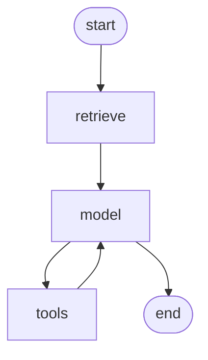

# 07 - LangGraph 状态图核心机制

> 第 06 篇我们看到：`create_agent` 内部就是一张"模型 ↔ 工具"的图。
> 这一篇把那张图**拆开、吃透、重新组装**。
> 学完你能回答三个问题：**状态怎么流转？分支怎么走？跑完的结果存在哪？**
> 这三个问题，也是所有 Agent 框架的底层机制。

---

## 📖 目录

1. [为什么需要状态图](#一为什么需要状态图)
2. [LangGraph 的四块积木](#二langgraph-的四块积木)
3. [State：状态的形状与更新规则 ⭐⭐](#三state状态的形状与更新规则-)
4. [Node：一个普通函数](#四node一个普通函数)
5. [Edge：确定边与条件边 ⭐⭐](#五edge确定边与条件边-)
6. [编译与执行：`compile()` 之后发生了什么](#六编译与执行compile-之后发生了什么)
7. [流式：四种 `stream_mode` 的选择 ⭐](#七流式四种-stream_mode-的选择-)
8. [Command 与 Send：进阶控制流 ⭐⭐](#八command-与-send进阶控制流-)
9. [子图：把图当节点用](#九子图把图当节点用)
10. [用图重写 Agent：从 30 行到手写图 ⭐⭐](#十用图重写-agent从-30-行到手写图-)
11. [图 vs 工作流 vs Agent](#十一图-vs-工作流-vs-agent)
12. [常见坑](#十二常见坑)
13. [完整示例：带人工审核的退款工单](#十三完整示例带人工审核的退款工单)
14. [本章小结与练习](#本章小结与练习)

---

## 一、为什么需要状态图

### 1.1 Agent 的三个不满足

第 06 篇的 `create_agent` 很好用，但真实业务会撞上三堵墙：

| 墙 | 表现 | 状态图怎么解决 |
| :--- | :--- | :--- |
| **过程不可控** | 想强制"先查订单再退款"，Agent 可能跳过 | 显式节点 + 边，顺序确定 |
| **状态看不见** | 中间有个"已退款待审核"的状态，无处放 | `State` 显式定义 |
| **不能暂停** | 需要人工审批，只能返回前端再重来 | Checkpointer + `interrupt`（第 08 篇） |

### 1.2 状态图的心智模型

**把它当成"带共享内存的状态机"。**

```text
       ┌───────────────┐
       │   State 内存  │  ← 所有节点读写的同一个 dict
       └───────┬───────┘
               │
   ┌───────────┼───────────┐
   ▼           ▼           ▼
[节点A]   →  [节点B]  →  [节点C]
```

- **State**：一块共享数据，所有节点都能读、都能写，但**写要遵守规则**（reducer）
- **节点**：函数，`state → 增量`
- **边**：决定下一步去哪个节点

**和普通函数的区别**：普通函数数据走调用栈，状态图数据走"共享黑板"，节点之间不直接调用。

### 1.3 这个模型解决了什么

| 传统 Agent 循环 | 状态图 |
| :--- | :--- |
| 状态藏在 Python 变量里 | 状态是显式结构，可序列化 |
| 中途没法停 | 每一步都能存盘 |
| 没法重放 | 有每一步的状态快照 |
| 分支逻辑和业务耦合 | 分支是独立的函数 |
| 没法单测节点 | 每个节点是纯函数，好测 |

> 💡 **一句话**：状态图把"Agent 的运行过程"从**内存里的黑箱**变成**可存、可放、可回放的事件流**。

---

## 二、LangGraph 的四块积木

```python
from langgraph.graph import StateGraph, START, END

builder = StateGraph(MyState)      # ① 定义状态
builder.add_node("a", node_a)      # ② 加节点
builder.add_node("b", node_b)
builder.add_edge(START, "a")       # ③ 加边
builder.add_edge("a", "b")
builder.add_edge("b", END)
graph = builder.compile()          # ④ 编译
```

| 积木 | 作用 | 类比 |
| :--- | :--- | :--- |
| `StateGraph(State)` | 声明状态结构 | 建表 DDL |
| `add_node` | 注册处理函数 | 服务方法 |
| `add_edge` | 连接节点 | 流程编排 |
| `compile()` | 生成可执行对象 | 编译成可执行计划 |

> ⚠️ **`START` 和 `END` 是虚拟节点**，不是真的函数。`START` 表示"入口"，`END` 表示"终止"。

---

## 三、State：状态的形状与更新规则 ⭐⭐

这是 LangGraph 最容易搞混的地方。**搞懂 reducer，就搞懂了 80% 的 LangGraph。**

### 3.1 默认行为：覆盖

```python
from typing import TypedDict

class State(TypedDict):
    query: str
    answer: str

def node_a(state: State) -> dict:
    return {"answer": "节点 A 的答案"}      # 只返回要改的字段

def node_b(state: State) -> dict:
    return {"answer": "节点 B 的答案"}      # 覆盖了 A 的
```

**规则**：节点返回的 dict 会**浅合并**到 state 上，同名字段**覆盖**。

### 3.2 `add_messages`：追加而非覆盖

对话历史必须**累加**，不能覆盖：

```python
from typing import Annotated
from langgraph.graph.message import add_messages
from langchain_core.messages import AnyMessage

class State(TypedDict):
    messages: Annotated[list[AnyMessage], add_messages]
```

```python
def node(state):
    return {"messages": [AIMessage("新消息")]}   # 追加，不是替换
```

`add_messages` 还做了两件事：

1. **按 `id` 去重/更新**：同 id 的消息会被替换（用于修正）
2. **把 `("user", "...")` 转成 `HumanMessage`**

```python
# 修正一条消息
return {"messages": [AIMessage(content="修正后的内容", id=old_msg.id)]}
```

### 3.3 自定义 reducer

```python
def merge_dict(left: dict, right: dict) -> dict:
    return {**left, **right}

def add_numbers(left: int, right: int) -> int:
    return left + right

def dedupe_list(left: list, right: list) -> list:
    return list(dict.fromkeys(left + right))

class State(TypedDict):
    config: Annotated[dict, merge_dict]
    count: Annotated[int, add_numbers]
    sources: Annotated[list[str], dedupe_list]
```

**reducer 的签名**：`(旧值, 节点返回的新值) -> 合并后的值`

> ⚠️ **reducer 必须是纯函数**，不能有副作用，否则重放会出问题。

### 3.4 并行节点的结果合并

```python
builder.add_edge("start", "a")
builder.add_edge("start", "b")     # a、b 并行
```

```python
class State(TypedDict):
    items: Annotated[list, operator.add]   # 并行各自返回 [x]、[y] → [x, y]
    summary: str                            # 两个都返回 → 冲突！
```

> ⚠️ **并行分支写同一字段且没有 reducer，会报 `INVALID_CONCURRENT_GRAPH_UPDATE`**。
> 解决：要么加 reducer，要么让各分支写不同字段，要么合并成一个节点。

### 3.5 State 设计原则

| 原则 | 说明 |
| :--- | :--- |
| **只放"流程需要"的字段** | 不要塞整个业务对象 |
| **可序列化** | 要能被 JSON/msgpack 编码（checkpoint 用） |
| **大对象存引用** | 文档内容存 ID，用时再查 |
| **字段有明确归属** | 哪个节点写、哪个节点读要清楚 |
| **用 `TypedDict` 或 `Pydantic`** | 前者轻、后者可校验 |

```python
from pydantic import BaseModel, Field

class OrderState(BaseModel):
    order_no: str = Field(pattern=r"^\d{5,20}$")
    status: str = "init"
    messages: Annotated[list[AnyMessage], add_messages] = []
    refund_amount: float | None = None
```

> 💡 **Pydantic State 有校验但更慢**。流程内部用 `TypedDict` 更快；需要对外/持久化时再校验。

### 3.6 常见错误

```python
# ❌ 错误：原地修改
def bad_node(state: State) -> State:
    state["count"] += 1
    return state            # 可能不触发更新，且破坏 reducer

# ✅ 正确：返回增量
def good_node(state: State) -> dict:
    return {"count": state["count"] + 1}
```

```python
# ❌ 错误：返回全部
def bad(state):
    return {**state, "x": 1}     # 整个 state 覆盖，可能清掉并行结果

# ✅ 正确：只返回改动的字段
def good(state):
    return {"x": 1}
```

---

## 四、Node：一个普通函数

### 4.1 签名

```python
def my_node(state: State) -> dict:
    ...
    return {"field": value}
```

**同步/异步都行**：

```python
async def my_node_async(state: State) -> dict:
    resp = await model.ainvoke(state["messages"])
    return {"messages": [resp]}
```

**访问 config**：

```python
from langchain_core.runnables import RunnableConfig

def my_node(state: State, config: RunnableConfig) -> dict:
    user_id = config["configurable"]["user_id"]
    ...
```

**访问 runtime（上下文、store、stream_writer）**：

```python
from langgraph.runtime import Runtime

def my_node(state: State, runtime: Runtime[Context]) -> dict:
    runtime.context.user_id
    runtime.store.get(("users",), "u1001")
    runtime.stream_writer({"type": "progress", "pct": 50})   # 自定义流
```

### 4.2 节点内该做什么、不该做什么

| 该做 | 不该做 |
| :--- | :--- |
| 单一职责 | 一个大节点做五件事 |
| 返回增量 | 原地修改 state |
| 调外部服务 | 依赖上一个节点的临时变量 |
| 抛异常让它冒泡 | 吞掉异常返回空 |
| 幂等（能重试） | 有不可逆副作用却不可重试 |

### 4.3 节点命名

```python
builder.add_node("retrieve", retrieve_node)      # 推荐：动词短语
builder.add_node("llm", llm_node)
builder.add_node("tools", tool_node)
```

> 💡 **节点名会出现在流式事件、追踪、日志里**。取短小明确的名字，别用 `node1`。

---

## 五、Edge：确定边与条件边 ⭐⭐

### 5.1 确定边

```python
builder.add_edge(START, "retrieve")
builder.add_edge("retrieve", "generate")
builder.add_edge("generate", END)
```

也可以**批量连**（fan-out / fan-in）：

```python
builder.add_edge(["a", "b"], "merge")    # a、b 都完成后才进 merge
```

### 5.2 条件边

```python
def route(state: State) -> str:
    if state["need_search"]:
        return "search"
    return "generate"

builder.add_conditional_edges(
    "classify",
    route,
    {"search": "search", "generate": "generate"},   # 返回值和节点名的映射
)
```

**`path` 函数返回"路由键"，第三个参数把键映射到节点。**

> ⚠️ **路由函数必须返回映射里存在的键**。返回未知键会抛 `InvalidUpdateError`。

### 5.3 循环

**LangGraph 允许环**，这就是 Agent 循环的实现：

```python
builder.add_edge("tools", "agent")     # 回到 agent，形成循环
```

```text
        ┌──────────┐
        ▼          │
    [agent] ──────►[tools]
        │
        ▼
       END
```

**循环何时停？** 靠条件边：

```python
def should_continue(state):
    last = state["messages"][-1]
    return "tools" if getattr(last, "tool_calls", None) else END

builder.add_conditional_edges("agent", should_continue, {"tools": "tools", END: END})
```

> ⚠️ **必须有终止路径**，否则 `recursion_limit` 兜底后抛异常。

### 5.4 `END` 的几种到达方式

```python
# ① 直接连
builder.add_edge("last_node", END)

# ② 条件边返回值是 END
builder.add_conditional_edges("a", lambda s: END if done else "b")

# ③ 都连到 END（多个终点）
builder.add_edge("a", END)
builder.add_edge("b", END)
```

### 5.5 路由的三种写法

```python
# 写法 1：函数返回字符串
def route(state) -> str:
    return "search" if state["need_search"] else "generate"

# 写法 2：Literal 类型（推荐，能静态检查）
from typing import Literal
def route(state) -> Literal["search", "generate"]:
    ...

# 写法 3：用 Command（见第八节，可在跳转时同时更新状态）
```

---

## 六、编译与执行：`compile()` 之后发生了什么

### 6.1 compile 做了什么

```python
graph = builder.compile(
    checkpointer=saver,            # 持久化（第 08 篇）
    interrupt_before=["tools"],    # 在这些节点前暂停
    interrupt_after=["draft"],     # 在这些节点后暂停
    store=store,                   # 长期记忆（第 05 篇）
    debug=False,
)
```

**校验**：孤立节点、不可达节点、缺失的边都会在编译时报错。
**产出**：一个 `CompiledGraph`，有 `invoke` / `ainvoke` / `stream` / `astream` / `get_state` / `update_state`。

### 6.2 执行模型：超步（super-step）

```text
超步 1: [START] → 节点 A 执行
超步 2: 节点 B、C 并行执行
超步 3: 节点 D 执行
超步 4: END
```

**并行的两个节点属于同一超步**，等所有并行分支完成再进入下一步。

> 💡 **这解释了两件事**：① 为什么并行分支写同字段会冲突（同超步）；② `recursion_limit` 数的是超步数，不是节点调用次数。

### 6.3 调用

```python
result = graph.invoke(
    {"messages": [("user", "你好")]},
    config={
        "configurable": {"thread_id": "t1"},
        "recursion_limit": 25,
        "tags": ["prod"],
        "metadata": {"user_id": "u1"},
    },
)
```

**`config` 是可传递的**：`configurable` 里的值，任何节点都能通过 `config` 参数拿到。

> ⚠️ **`thread_id` 用 checkpointer 时必填**，否则抛错。没配 checkpointer 时不需要。

### 6.4 输入与输出的形状

```python
# 输入：只传初始状态中非 reducer 的字段
graph.invoke({"messages": [...], "query": "..."})

# 输出：最终完整 state
{"messages": [...], "query": "...", "answer": "..."}
```

> ⚠️ **不要一次性传完整 state**。初始值只给"入口需要的"，其余由节点填充。

---

## 七、流式：四种 `stream_mode` 的选择 ⭐

### 7.1 四种模式

```python
for chunk in graph.stream(inputs, stream_mode="updates"):
    ...
```

| 模式 | 产出 | 典型用途 |
| :--- | :--- | :--- |
| `values` | 每一步后的**完整 state** | 调试、简单进度 |
| `updates` | 每个节点返回的**增量** | 展示"步骤完成" |
| `messages` | 消息 + token 级 | 逐字输出 |
| `custom` | `runtime.stream_writer` 写的自定义事件 | 业务进度条 |

### 7.2 对比

```python
# values
for s in graph.stream(inputs, stream_mode="values"):
    print(s["status"])        # 完整状态

# updates
for u in graph.stream(inputs, stream_mode="updates"):
    print(u)                  # {"node_name": {...增量...}}

# messages
for msg_chunk, meta in graph.stream(inputs, stream_mode="messages"):
    print(msg_chunk.content, end="")

# custom（节点内 runtime.stream_writer 写入）
for ev in graph.stream(inputs, stream_mode="custom"):
    print(ev)
```

### 7.3 组合模式

```python
for mode, chunk in graph.stream(inputs, stream_mode=["updates", "messages"]):
    if mode == "updates":
        ...
    else:
        ...
```

### 7.4 自定义事件

```python
def retrieve_node(state, runtime: Runtime):
    runtime.stream_writer({"type": "stage", "name": "检索中"})
    docs = search(state["query"])
    runtime.stream_writer({"type": "stage", "name": "检索完成", "count": len(docs)})
    return {"docs": docs}
```

```python
for ev in graph.stream(inputs, stream_mode="custom"):
    print(ev)   # {"type": "stage", ...}
```

> 💡 **前端进度条的推荐组合**：`updates` 拿节点级进度 + `messages` 拿逐字 + `custom` 拿细粒度业务事件。

### 7.5 异步

```python
async for chunk in graph.astream(inputs, stream_mode="updates"):
    ...
```

> ⚠️ **异步图里节点必须是 `async def`**，否则会阻塞事件循环（LangGraph 会警告）。

---

## 八、Command 与 Send：进阶控制流 ⭐⭐

### 8.1 `Command`：在一个节点里"更新 + 跳转"

普通条件边是"我返回什么，路由去哪"。`Command` 允许**节点直接决定下一步**，同时更新状态：

```python
from langgraph.types import Command
from typing import Literal

def route_node(state: State) -> Command[Literal["search", "generate"]]:
    if state["need_search"]:
        return Command(
            goto="search",
            update={"status": "searching"},     # 同时更新状态
        )
    return Command(goto="generate", update={"status": "generating"})

builder.add_node("route", route_node)
builder.add_edge(START, "route")
```

**优势**：不用单独写 `add_conditional_edges`，路由和状态更新在一处，逻辑更内聚。

> 💡 **`Command[Literal[...]]` 的类型标注是给图渲染和静态检查用的**，不写也能跑，但写了更好。

### 8.2 回到父图

```python
def sub_node(state) -> Command:
    # 在子图中，跳回父图
    return Command(goto=Command.PARENT, update={"result": ...})
```

### 8.3 `Send`：动态并行（Map-Reduce）

条件边是"固定几个分支选一个"。`Send` 是"**动态生成 N 个并行任务**"：

```python
from langgraph.types import Send

def fan_out(state: State):
    # 每个子问题发一个任务，并行处理
    return [Send("process_sub_q", {"sub_q": q}) for q in state["sub_questions"]]

builder.add_conditional_edges("plan", fan_out, ["process_sub_q"])
builder.add_edge("process_sub_q", "aggregate")   # 所有并行任务完成后汇总
```

**State 里必须用 reducer 收集结果**：

```python
class State(TypedDict):
    sub_questions: list[str]
    results: Annotated[list[str], operator.add]     # 并行结果自动追加
```

> 💡 **`Send` 的典型场景**：文档批量处理、多查询并行检索、批量工单分类。**比 `asyncio.gather` 好在：有 checkpointer，可恢复。**

### 8.4 `Command` vs 条件边 vs `Send`

| | 什么时候用 |
| :--- | :--- |
| `add_conditional_edges` | 简单分支，路由逻辑独立 |
| `Command` | 分支不固定 / 需要同时更新状态 / 复杂路由 |
| `Send` | 运行时才知道数量的并行任务 |

---

## 九、子图：把图当节点用

### 9.1 两种用法

**用法 A：子图有自己的 State**

```python
sub_builder = StateGraph(SubState)
sub_builder.add_node("x", x_node)
sub_builder.add_edge(START, "x")
sub_builder.add_edge("x", END)
sub_graph = sub_builder.compile()

builder.add_node("sub", sub_graph)      # 直接把编译好的图当节点
```

**要求**：父 State 和子 State 要有**同名同类型的键**用于对接。

```python
class ParentState(TypedDict):
    messages: Annotated[list, add_messages]
    result: str

class SubState(TypedDict):
    messages: Annotated[list, add_messages]    # 同名，可传
    scratch: dict                               # 独立字段
```

**用法 B：子图共享父 State**

```python
def call_sub(state: ParentState):
    return sub_graph.invoke(state)      # 当普通函数调用

builder.add_node("sub", call_sub)
```

### 9.2 子图的价值

| 场景 | 好处 |
| :--- | :--- |
| 多 Agent | 每个 Agent 一张图，独立开发测试 |
| 可复用流程 | 同一子图嵌入多个主流程 |
| 隔离状态 | 子图内部字段不污染父图 |
| 独立演化 | 改子图不影响父流程契约 |

> ⚠️ **子图的 checkpointer 会继承父图**。子图里的 `thread_id` 需要加命名空间区分，否则可能冲突。

### 9.3 流式穿透

```python
graph.stream(inputs, stream_mode="updates", subgraphs=True)
# 输出 (namespace, update)，namespace 形如 ("sub",)
```

---

## 十、用图重写 Agent：从 30 行到手写图 ⭐⭐

### 10.1 手写一个"查询 + 生成"的 Agent

```python
from typing import Annotated, Literal, TypedDict
from langgraph.graph import StateGraph, START, END
from langgraph.graph.message import add_messages
from langgraph.checkpoint.memory import InMemorySaver
from langchain_core.messages import AnyMessage, SystemMessage, ToolMessage


class AgentState(TypedDict):
    messages: Annotated[list[AnyMessage], add_messages]
    steps: Annotated[int, lambda a, b: a + b]


def call_model(state: AgentState) -> dict:
    resp = model.bind_tools(TOOLS).invoke(
        [SystemMessage(SYSTEM)] + state["messages"]
    )
    return {"messages": [resp], "steps": 1}


def call_tools(state: AgentState) -> dict:
    last = state["messages"][-1]
    outs = []
    for tc in last.tool_calls:
        try:
            result = TOOL_MAP[tc["name"]].invoke(tc["args"])
        except Exception as e:
            result = f"工具执行失败：{e}。请告知用户或换一种方式。"
        outs.append(ToolMessage(content=str(result), tool_call_id=tc["id"]))
    return {"messages": outs}


def route(state: AgentState) -> Literal["tools", "__end__"]:
    if state["steps"] >= MAX_STEPS:
        return END
    return "tools" if state["messages"][-1].tool_calls else END


builder = StateGraph(AgentState)
builder.add_node("model", call_model)
builder.add_node("tools", call_tools)
builder.add_edge(START, "model")
builder.add_conditional_edges("model", route, {"tools": "tools", END: END})
builder.add_edge("tools", "model")

agent = builder.compile(checkpointer=InMemorySaver())
```

### 10.2 为什么值得这么写

```python
# 加一个"检索"节点（create_agent 做不到这么自然）
builder.add_node("retrieve", retrieve_node)
builder.add_edge(START, "retrieve")
builder.add_edge("retrieve", "model")

# 加一个"写操作必须审批"的节点
builder.add_node("approve", approve_node)
builder.add_conditional_edges("tools", needs_approval,
                              {"approve": "approve", "model": "model"})

# 加一个"总结"节点
builder.add_edge("model", "finalize")   # 改条件边即可
```

**每一处改动都是显式的、可测的、可渲染的。**

### 10.3 对比表

| 能力 | `create_agent` | 手写图 |
| :--- | :--- | :--- |
| 上手速度 | ⭐⭐⭐ | ⭐ |
| 流程可控 | ⭐ | ⭐⭐⭐ |
| 定制节点 | 中间件 | 任意 |
| 单测节点 | 难 | 易（纯函数） |
| 图可视化 | 黑盒 | `graph.get_graph().draw_mermaid()` |
| 多 Agent | 嵌套工具 | 子图 |

### 10.4 可视化

```python
print(graph.get_graph().draw_mermaid())
```



> 💡 **画图不只是好看**——它是评审时最有用的沟通材料。上线前把图贴进设计文档。

---

## 十一、图 vs 工作流 vs Agent

### 11.1 三个层次

```text
工作流（Workflow）   ← 路径完全确定
   ↓ 加入条件分支
状态图（Graph）     ← 路径有限、可枚举
   ↓ 加入"模型决定下一步"
Agent              ← 路径运行时才确定
```

### 11.2 什么时候用哪个

| 特征 | 推荐 |
| :--- | :--- |
| 步骤固定、每步都是确定逻辑 | 普通函数 / 简单工作流 |
| 有分支、需要状态、需要暂停恢复 | **LangGraph 状态图** |
| 步骤数和顺序需要模型动态决定 | Agent（`create_agent` 或图 + 循环） |
| 大部分固定，局部需要灵活性 | **图的某个节点内用 `create_agent`** |

### 11.3 推荐架构

```text
LangGraph 主图（业务流程）
 ├─ 节点：意图识别（模型）
 ├─ 节点：检索（代码）
 ├─ 节点：答疑 Agent（create_agent 子图）
 ├─ 节点：工单创建（代码 + 校验）
 └─ 节点：人工审批（interrupt）
```

> 💡 **不要二选一**。"外层图管流程，内层 Agent 管灵活"是生产上最稳的形态。

---

## 十二、常见坑

```python
# 坑 1：并行分支写同一字段无 reducer
builder.add_edge("start", "a")
builder.add_edge("start", "b")   # a、b 都 return {"x": ...} → 报错
# 修复：加 reducer 或用不同字段

# 坑 2：忘记加终止条件，图跑不完
# 修复：条件边必须有回 END 的路径 + recursion_limit

# 坑 3：节点返回整个 state
def bad(state): return {**state, "x": 1}
# 修复：只返回改动的字段

# 坑 4：原地修改 state
state["messages"].append(msg)   # 不触发更新
# 修复：return {"messages": [msg]}

# 坑 5：用 checkpointer 但没传 thread_id
graph.invoke(inputs)            # 报错
# 修复：config={"configurable": {"thread_id": "..."}}

# 坑 6：Conditional edge 返回未映射的键
def route(s): return "unknown"
builder.add_conditional_edges("a", route, {"search": "search"})   # 报错
# 修复：映射里覆盖所有可能返回值

# 坑 7：State 里有不可序列化对象
class State(TypedDict):
    client: httpx.Client       # 无法存 checkpoint
# 修复：客户端放模块级或 runtime.context

# 坑 8：同步节点放进 async 图
def slow_node(state): ...
# 修复：async def + await
```

### 坑速查表

| 报错 / 现象 | 原因 | 修复 |
| :--- | :--- | :--- |
| `INVALID_CONCURRENT_GRAPH_UPDATE` | 并行写同字段无 reducer | 加 reducer |
| `GraphRecursionError` | 无终止 / 死循环 | 加终止条件 |
| `thread_id` 缺失 | 有 checkpointer | 传 `configurable.thread_id` |
| 状态没更新 | 原地修改 | 返回增量 |
| 状态被清空 | 返回整个 state | 只返回改动字段 |
| 节点没执行 | 边未连 / 不可达 | 检查边 |
| 无限循环 | 条件边总返回非 END | 检查路由逻辑 |
| 序列化失败 | State 有对象 | 存 ID 不存对象 |

---

## 十三、完整示例：带人工审核的退款工单

```python
# refund_graph.py
import uuid
from typing import Annotated, Literal, TypedDict
from pydantic import BaseModel, Field
from langgraph.graph import StateGraph, START, END
from langgraph.graph.message import add_messages
from langgraph.checkpoint.memory import InMemorySaver
from langgraph.types import interrupt
from langchain_core.messages import AnyMessage, HumanMessage, AIMessage


class RefundState(TypedDict):
    order_no: str
    amount: float
    reason: str
    risk_level: str            # low | high
    need_human: bool
    approved: bool | None
    refund_id: str | None
    messages: Annotated[list[AnyMessage], add_messages]
    steps: Annotated[int, lambda a, b: a + b]


# ---------- 节点 ----------

def validate_node(state: RefundState) -> dict:
    """校验订单可退款性。"""
    detail = order_service.get(state["order_no"])
    if not detail:
        return {"messages": [AIMessage("订单不存在")], "risk_level": "high",
                "need_human": True}
    if detail.status not in ("已发货", "已完成"):
        return {"messages": [AIMessage(f"订单状态 {detail.status} 不可退款")],
                "risk_level": "high", "need_human": True}
    return {"amount": detail.amount, "risk_level": "low"}


def risk_node(state: RefundState) -> dict:
    """风控判定。规则确定，不用模型。"""
    high = (
        state["amount"] > 5000
        or user_service.refund_count(state.get("user_id", ""), days=30) >= 3
    )
    return {"risk_level": "high" if high else "low", "need_human": high}


def route_after_risk(state: RefundState) -> Literal["approve", "execute"]:
    return "approve" if state["need_human"] else "execute"


def approve_node(state: RefundState) -> dict:
    """人工审批。真的暂停，等外部恢复。"""
    decision = interrupt({
        "type": "refund_approval",
        "order_no": state["order_no"],
        "amount": state["amount"],
        "risk": state["risk_level"],
    })
    return {"approved": bool(decision.get("approved")),
            "messages": [AIMessage(f"审批结果：{'通过' if decision.get('approved') else '驳回'}")]}


def route_after_approve(state: RefundState) -> Literal["execute", "reject"]:
    return "execute" if state["approved"] else "reject"


def execute_node(state: RefundState) -> dict:
    """执行退款（幂等键）。"""
    rid = order_service.refund(
        state["order_no"], state["amount"],
        idempotency_key=f"refund:{state['order_no']}",
    )
    return {"refund_id": rid,
            "messages": [AIMessage(f"退款已提交，单号 {rid}，预计 1-3 个工作日到账。")]}


def reject_node(state: RefundState) -> dict:
    return {"messages": [AIMessage("退款申请未通过审核，请联系客服。")]}


# ---------- 组图 ----------

builder = StateGraph(RefundState)
builder.add_node("validate", validate_node)
builder.add_node("risk", risk_node)
builder.add_node("approve", approve_node)
builder.add_node("execute", execute_node)
builder.add_node("reject", reject_node)

builder.add_edge(START, "validate")
builder.add_edge("validate", "risk")
builder.add_conditional_edges("risk", route_after_risk,
                              {"approve": "approve", "execute": "execute"})
builder.add_conditional_edges("approve", route_after_approve,
                              {"execute": "execute", "reject": "reject"})
builder.add_edge("execute", END)
builder.add_edge("reject", END)

refund_graph = builder.compile(checkpointer=InMemorySaver())
```

### 13.1 调用

```python
config = {"configurable": {"thread_id": f"refund-{uuid.uuid4().hex[:8]}"}}

# 第一次：跑到 approve 节点会挂起
state = refund_graph.invoke(
    {"order_no": "12345", "reason": "质量问题"}, config
)
print(state.get("__interrupt__"))     # 有值说明挂起了

# 外部审批后恢复
from langgraph.types import Command
state = refund_graph.invoke(Command(resume={"approved": True}), config)
print(state["refund_id"])
```

### 13.2 这个例子的设计要点

| 设计 | 说明 |
| :--- | :--- |
| 校验、风控是**代码节点** | 确定性逻辑不用模型，快且可控 |
| 风控用一个 `Literal` 路由 | 分支清晰，可单测 |
| `interrupt` 真正暂停 | 不在进程内空等，可跨重启 |
| 幂等键 | 重放不会重复退款 |
| 状态全可序列化 | checkpoint 能落盘 |
| `steps` 用 reducer | 多分支累加 |

> 💡 **注意这个流程几乎没有"模型"**。这不是缺陷——**能用代码写死的，就别交给模型**。模型只在"理解用户说什么""生成解释"这类地方出现。

---

## 十四、本章小结与练习

### 核心结论

1. **状态图 = 共享 State + 节点函数 + 边**，把 Agent 从内存黑箱变成可存可放的过程。
2. **reducer 是核心**：默认覆盖，`add_messages` 追加，并行必须显式 reducer。
3. **节点只返回增量**，不要原地修改，不要返回整个 state。
4. **条件边的路由函数必须返回映射中存在的键**，循环必须有终止路径。
5. **超步是执行单位**：并行节点同属一个超步，`recursion_limit` 数的是超步。
6. **`stream_mode` 四选一**：`values` 调试、`updates` 进度、`messages` 逐字、`custom` 业务事件。
7. **`Command` 让节点自己决定跳转**，`Send` 做动态并行（Map-Reduce）。
8. **子图当节点用**，是多 Agent 的组织方式。
9. **能用代码写的用代码，模型只放需要理解的地方**；推荐"外层图管流程，内层 Agent 管灵活"。
10. **`graph.get_graph().draw_mermaid()`** 是设计评审的必备产出。

### 动手练习

1. 手写第 10 节的 Agent 图，跑通后加一个"检索"节点，插在 `model` 之前。
2. 用 `Annotated[list, operator.add]` 实现一个并行检索（两个检索节点 + 一个汇总节点），观察合并行为。
3. 故意让两个并行节点都写同一个无 reducer 的字段，观察报错，然后修复。
4. 用 `Command` 重写一个条件边，体会写法差异。
5. 用 `Send` 实现"把一段长文档按章节拆开并行摘要"。
6. 把第 13 节例子的 `InMemorySaver` 换成 `PostgresSaver`，验证重启后还能用 `Command(resume=...)` 恢复。
7. 用 `stream_mode="custom"` 在节点内发进度事件，做一个前端进度条。
8. 打印 `draw_mermaid()`，把图贴到你的项目 README 里。

### 下一篇

[08 - LangGraph 持久化与人工介入](08-LangGraph持久化与人工介入.md) —— 让图能暂停、能恢复、能回放、能等人。
